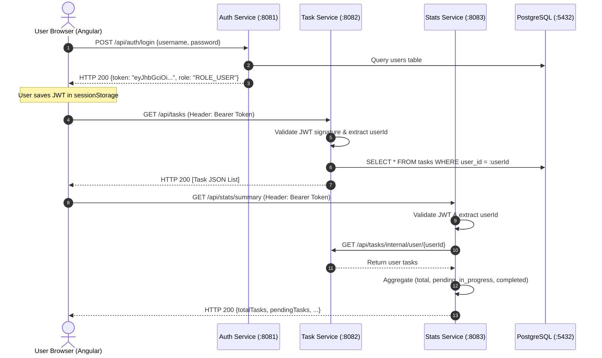

# TaskFlow Architecture & Communication Guide

This document describes the technical architecture, microservice boundaries, inter-service REST communication, and frontend security design for TaskFlow.

---

## 1. System Components & Port Allocations

| Component | Port | Technology | Database | Key Responsibilities |
| :--- | :---: | :--- | :--- | :--- |
| **`auth-service`** | `8081` | Spring Boot 3 / Java 21 | `auth_db` | User registration, login, BCrypt hashing, JWT issuance. |
| **`task-service`** | `8082` | Spring Boot 3 / Java 21 | `task_db` | Task CRUD, user ownership validation, status lifecycle. |
| **`stats-service`** | `8083` | Spring Boot 3 / Java 21 | *None (Stateless)* | Metric aggregation via downstream REST calls to `task-service`. |
| **`frontend`** | `4200` | Angular 18 (Standalone) | *Client SPA* | User authentication, task dashboard, interactive status updates. |

---

## 2. Service Communication Flow

---

## 3. Browser Authentication & Token Storage Strategy

### Why `localStorage` is Avoided by Default
In many quick tutorials, developers place JWTs in `window.localStorage`.
- **The Risk**: Any third-party JavaScript library or Cross-Site Scripting (XSS) vulnerability can immediately access `window.localStorage.getItem('token')` and exfiltrate the user's credentials.

### Security Trade-Offs Matrix

| Storage Strategy | Persistence | XSS Risk | CSRF Risk | Recommendation |
| :--- | :--- | :---: | :---: | :--- |
| **`localStorage`** | Survives browser close | High | None | Avoid for sensitive tokens. |
| **`sessionStorage`** | Cleared when tab closes | Moderate | None | Good balance for development labs and single-tab sessions. |
| **In-Memory JavaScript Variable** | Lost on page refresh | Lowest | None | Best security, requires refresh token rotation. |
| **`httpOnly` Secure Cookie** | Configurable expiry | Immune to JS reading | Requires CSRF protection | **Enterprise Production Standard** |

*In TaskFlow*, the Angular frontend uses `sessionStorage` with reactive Angular signals. Tokens are automatically cleared on tab closure or logout, preventing persistent credential leakage.

---

## 4. Inter-Service Communication Patterns

### Synchronous REST (`StatsService` -> `TaskService`)
- Implemented using Spring 6's modern **`RestClient`** builder.
- Configured via `task-service.base-url`:
  - `localdev`: `http://localhost:8082`
  - `localserver`: `http://task-service:8082` (Docker/K8s service name)
- **Error Handling**: If `task-service` is temporarily down, `StatsService` intercepts `RestClientException` and returns HTTP 503 (`SERVICE_UNAVAILABLE`) with a descriptive diagnostic message rather than crashing.
