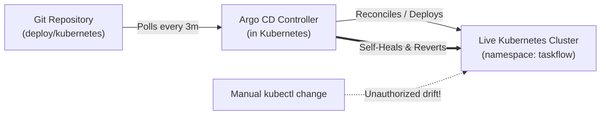

# TaskFlow GitOps Guide: Argo CD

This guide teaches the principles and practice of **GitOps** using **Argo CD** in a local Kubernetes cluster without requiring paid cloud infrastructure.

---

## 1. What is GitOps & Why Do Teams Use It?

In traditional deployment pipelines (Push-based):
- A Jenkins or GitHub Actions pipeline runs `kubectl apply` using cluster admin credentials.
- **The Problem**: If a developer runs `kubectl edit` directly on the cluster during an emergency, the cluster drifts away from Git. There is no audit log of what is actually running in production.

**The GitOps Pattern (Pull-based)**:
- **Git is the Single Source of Truth**: The Git repository contains the entire desired state of the cluster.
- **Argo CD** runs inside the Kubernetes cluster as an autonomous controller.
- It continuously compares the **Desired State** (in Git) against the **Live State** (in Kubernetes).
- If anything changes or drifts, Argo CD triggers **Self-Healing** or alerts the team.



---

## 2. Installing Argo CD in Local Kubernetes

### Step 1: Create Namespace and Apply Argo CD Manifests
```powershell
kubectl create namespace argocd
kubectl apply -n argocd -f https://raw.githubusercontent.com/argoproj/argo-cd/stable/manifests/install.yaml
```

### Step 2: Wait for Argo CD Pods to Be Ready
```powershell
kubectl wait --for=condition=ready pod -l app.kubernetes.io/name=argocd-server -n argocd --timeout=300s
```

### Step 3: Access the Argo CD Web UI
Forward the Argo CD server to your localhost:
```powershell
kubectl port-forward svc/argocd-server -n argocd 8085:443
```
Open your browser to: `https://localhost:8085` *(accept the self-signed certificate warning)*.

### Step 4: Retrieve Default Admin Password
```powershell
kubectl -n argocd get secret argocd-initial-admin-secret -o jsonpath="{.data.password}" | [System.Text.Encoding]::UTF8.GetString([System.Convert]::FromBase64String($input))
```
- **Username**: `admin`
- **Password**: *(The decoded string from the command above)*.

---

## 3. Registering the TaskFlow Application in Argo CD

Apply the AppProject and Application manifests:
```powershell
cd TaskFlow/deploy/argocd
kubectl apply -f app-project.yaml
kubectl apply -f application.yaml
```

In the Argo CD UI, you will see a card named **`taskflow-app`**:
- **Health**: `Healthy` (green heart)
- **Sync Status**: `Synced` (green checkmark)
- Clicking the card opens a live, real-time visual dependency graph of all Deployments, Pods, Services, and ConfigMaps!

---

## 4. Key Argo CD Features: Automated Sync & Self-Healing

In [deploy/argocd/application.yaml](file:///e:/Projects/task_flow_app/TaskFlow/deploy/argocd/application.yaml):
```yaml
syncPolicy:
  automated:
    prune: true
    selfHeal: true
```
- **`prune: true`**: If you delete a manifest file from the Git repo (e.g. remove an obsolete service), Argo CD automatically deletes that resource from Kubernetes.
- **`selfHeal: true`**: If someone manually changes a resource in Kubernetes using `kubectl`, Argo CD detects the divergence and overwrites the manual change to restore what is committed in Git!

---

## 5. The CI-to-GitOps Handshake (How Jenkins & Argo CD Work Together)

1. Developer pushes code to Java backend.
2. **Jenkins** runs unit tests and builds Docker image `taskflow-auth-service:v42`.
3. Jenkins pushes image to registry (local or AWS ECR).
4. Jenkins updates the image tag inside Git:
   `deploy/kubernetes/auth-service/auth-deployment.yaml` -> `image: taskflow-auth-service:v42`.
5. Jenkins commits and pushes this tag change to Git.
6. **Argo CD** detects the Git commit, marks the app `OutOfSync`, and triggers a rolling update in Kubernetes.
*Result: Clean separation of concerns. CI builds and tests; GitOps reconciles and deploys.*

---

## 6. Hands-on Learning Exercises

### Exercise 1: Drift Detection & Self-Healing Drill
1. Ensure `taskflow-app` is healthy in Argo CD.
2. Intentionally edit a deployment manually via `kubectl` to simulate an unauthorized cluster change:
   ```powershell
   kubectl scale deployment task-service --replicas=5 -n taskflow
   ```
3. Immediately refresh the Argo CD UI:
   - Notice Argo CD instantly flags the deployment as `OutOfSync`.
   - Because `selfHeal: true` is active, Argo CD immediately scales it back down to `2` to match the Git manifest!
   - You have just observed **automated GitOps self-healing** in action.

---

### Exercise 2: Declarative Scaling via Git
1. Open `deploy/kubernetes/task-service/task-deployment.yaml`.
2. Change `replicas: 2` to `replicas: 3`.
3. Commit the change to Git.
4. Click **Sync** in Argo CD (or wait for the automatic polling cycle).
5. Watch Argo CD spawn the 3rd pod in the cluster visualizer.
