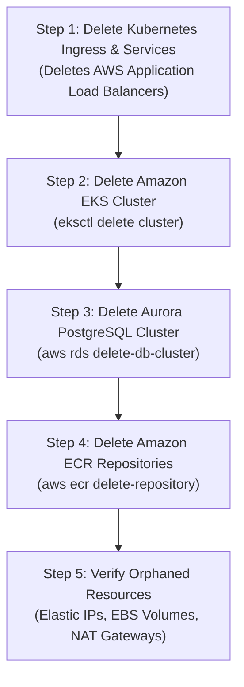

# AWS Teardown & Resource Cleanup Checklist

> [!CAUTION]
> **Deleting only the EKS cluster does NOT delete all billable AWS resources!**
> If you leave Application Load Balancers, Elastic IPs, NAT Gateways, Aurora clusters, or EBS volumes behind, AWS will continue to bill you. Follow this teardown checklist in **strict reverse order**.

---

## 1. Complete Teardown Checklist



---

## 2. Step-by-Step Cleanup Commands

### Step 1: Delete Ingress & Load Balancers First
Kubernetes Services of type `LoadBalancer` or Ingress resources provision AWS Application Load Balancers outside of CloudFormation. If you delete the cluster first, the ALB will become orphaned and continue to cost ~$20+/month!

```bash
# Delete all resources in the taskflow namespace
kubectl delete namespace taskflow

# Wait 2 minutes for AWS Load Balancer Controller to release the AWS ALB
```

### Step 2: Delete the Amazon EKS Cluster
```bash
eksctl delete cluster --name taskflow-eks --region us-east-1
```
*(This automatically terminates worker node EC2 instances, security groups, and CloudFormation stacks created by `eksctl`).*

### Step 3: Delete Aurora PostgreSQL Cluster
```bash
# Delete DB instance first
aws rds delete-db-instance \
    --db-instance-identifier taskflow-aurora-instance-1 \
    --skip-final-snapshot \
    --region us-east-1

# Delete cluster
aws rds delete-db-cluster \
    --db-cluster-identifier taskflow-aurora-cluster \
    --skip-final-snapshot \
    --region us-east-1

# Delete DB subnet group
aws rds delete-db-subnet-group \
    --db-subnet-group-name taskflow-db-subnet-group \
    --region us-east-1
```

### Step 4: Delete ECR Repositories
```bash
aws ecr delete-repository --repository-name taskflow-auth-service --force --region us-east-1
aws ecr delete-repository --repository-name taskflow-task-service --force --region us-east-1
aws ecr delete-repository --repository-name taskflow-stats-service --force --region us-east-1
aws ecr delete-repository --repository-name taskflow-frontend --force --region us-east-1
```

### Step 5: Delete CloudWatch Log Groups
```bash
aws logs delete-log-group --log-group-name /aws/eks/taskflow-eks/cluster --region us-east-1
```

---

## 3. Verification Commands: Ensuring Zero Orphaned Charges

Run these commands to verify that no billable resources remain active:

### Check for Remaining Load Balancers:
```bash
aws elbv2 describe-load-balancers --region us-east-1 --query "LoadBalancers[*].LoadBalancerArn" --output table
```
*(Should return empty).*

### Check for Unattached Elastic IPs (AWS bills for unused IPs!):
```bash
aws ec2 describe-addresses --region us-east-1 --query "Addresses[?AssociationId==null].PublicIp" --output table
```
If any IP appears:
```bash
aws ec2 release-address --allocation-id <AllocationId>
```

### Check for Orphaned EBS Volumes:
```bash
aws ec2 describe-volumes --region us-east-1 --filters Name=status,Values=available --query "Volumes[*].VolumeId" --output table
```
If any unattached volume appears:
```bash
aws ec2 delete-volume --volume-id <VolumeId>
```

### Check Billing Dashboard:
Open the **AWS Cost Explorer** or **Billing Dashboard** 24 hours after cleanup to ensure daily spend has returned to **$0.00**.
