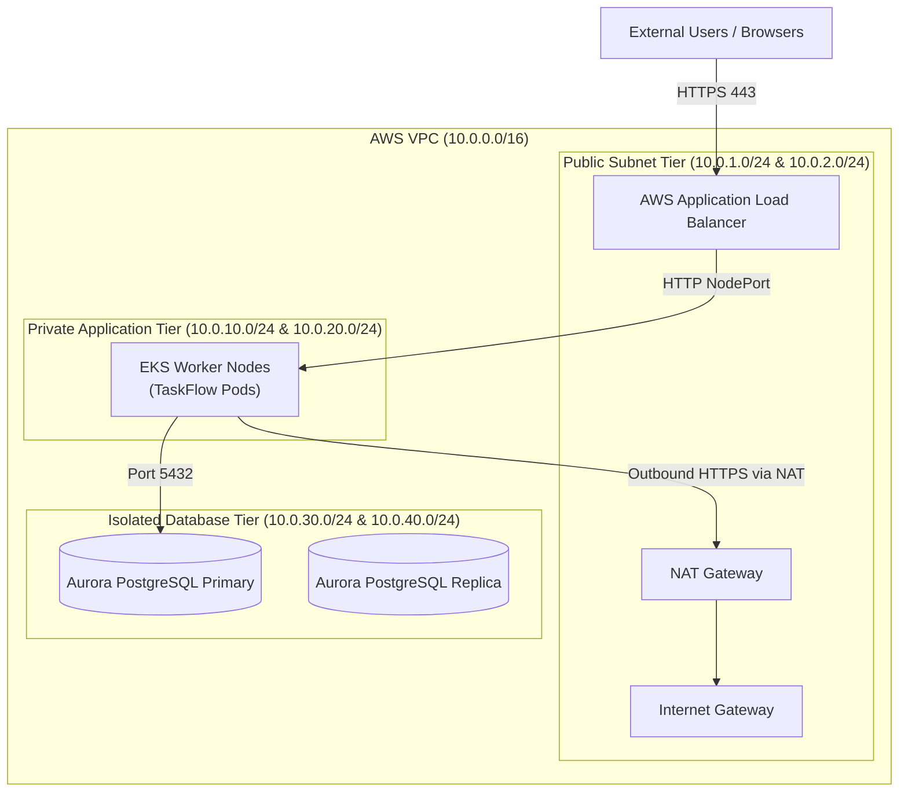
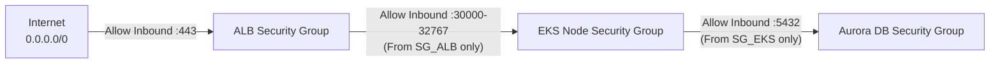

# AWS Networking & Security Architecture for TaskFlow

This document details the production networking topology, security group boundaries, IAM least-privilege policies, and secrets management for running TaskFlow on AWS.

---

## 1. Network Topology (VPC Architecture)

The TaskFlow AWS architecture uses a dedicated Virtual Private Cloud (VPC) spanning two Availability Zones (`us-east-1a` and `us-east-1b`) divided into three distinct subnet tiers:



### Subnet Tiers:
1. **Public Subnets**: Contain the Internet Gateway, Application Load Balancers, and NAT Gateways. Direct internet routing exists.
2. **Private Application Subnets**: Contain the Amazon EKS EC2 worker nodes. Nodes have private IP addresses only. Outbound internet access (to download Maven dependencies or pull ECR images) flows through the NAT Gateway.
3. **Isolated Database Subnets**: Contain the Amazon Aurora DB Subnet Group. Zero internet routing or NAT gateways. Accessible *only* from the EKS worker nodes.

---

## 2. Security Group Defense-in-Depth

Every tier has its own stateful Security Group (SG) acting as a virtual firewall:



- **`sg-alb`**: Allows inbound TCP 80/443 from `0.0.0.0/0`.
- **`sg-eks-nodes`**: Allows inbound traffic on NodePorts *only* if the source is `sg-alb`.
- **`sg-aurora`**: Allows inbound TCP 5432 *only* if the source is `sg-eks-nodes`.
> [!IMPORTANT]
> The database is physically unreachable from the public internet. Even if a bad actor obtains database credentials, they cannot connect from outside the VPC.

---

## 3. IAM Least Privilege & IRSA (IAM Roles for Service Accounts)

### Why Hardcoded AWS Credentials Are Prohibited
Never create an IAM User with long-lived `AWS_ACCESS_KEY_ID` and `AWS_SECRET_ACCESS_KEY` to mount into Kubernetes pods. If the pod is compromised, the keys can be stolen.

### The Modern Standard: IRSA
With EKS and IAM OIDC (OpenID Connect), pods authenticate directly to AWS using temporary STS tokens:
1. EKS creates a Kubernetes `ServiceAccount`:
   ```yaml
   apiVersion: v1
   kind: ServiceAccount
   metadata:
     name: taskflow-app-sa
     namespace: taskflow
     annotations:
       eks.amazonaws.com/role-arn: arn:aws:iam::123456789012:role/TaskFlowWorkloadRole
   ```
2. When the Spring Boot pod starts, the AWS EKS webhook injects a projected token.
3. The AWS SDK in Java automatically exchanges this token for short-lived AWS credentials (rotated hourly).

---

## 4. Production Secrets Management

For production deployments:
1. Store database passwords and JWT secrets in **AWS Secrets Manager**.
2. Use the **External Secrets Operator (ESO)** in Kubernetes.
3. ESO automatically syncs the secret from AWS Secrets Manager into a native Kubernetes Secret without committing secrets into Git.
