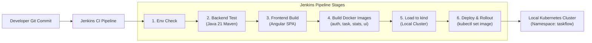

# TaskFlow CI/CD Pipeline Guide: Jenkins & GitHub Actions

This guide explains continuous integration and automated local deployment for the TaskFlow application using **Jenkins** (Primary Option) and **GitHub Actions** (Secondary Option).

---

## 1. CI/CD Architecture Overview



---

## 2. Jenkins Pipeline Breakdown (`ci/jenkins/Jenkinsfile`)

### A. Pipeline Stages
1. **Environment Check**: Verifies Java 21, Maven 3.9+, Node, Docker, and `kubectl` on the build agent.
2. **Backend Build & Automated Tests**: Executes `mvn clean verify` on all three microservices. Automatically parses Surefire XML reports and visualizes unit test status in the Jenkins UI.
3. **Frontend Build**: Executes `npm ci` and compiles Angular production bundles.
4. **Build Docker Images**: Builds all 4 container images tagged with the unique build number `v${BUILD_NUMBER}`.
5. **Load Images to Local Cluster**: In a local setup (like `kind`), pushes images directly into cluster nodes using `kind load docker-image` without needing a paid cloud registry like AWS ECR.
6. **Deploy to Kubernetes**: Uses `kubectl apply -k` and `kubectl set image` to trigger rolling updates.
7. **Verify Rollout Status**: Waits for `kubectl rollout status` to ensure all new pods are healthy before marking the build as SUCCESS.

---

## 3. How Jenkins Accesses Docker & Local Kubernetes

### A. Accessing the Docker Daemon
When Jenkins runs inside a container, running a separate Docker daemon inside Docker (DinD) is complex and requires privileged mode.
**The Industry Standard Approach (Docker Socket Mounting)**:
We mount the host machine's `/var/run/docker.sock` into the Jenkins container:
```yaml
volumes:
  - /var/run/docker.sock:/var/run/docker.sock
```
This allows the Jenkins CLI to communicate directly with the host's Docker engine. Any images built inside Jenkins immediately exist in the local Docker engine!

### B. Accessing Local Kubernetes (`kubectl`)
We mount the host's kubeconfig into the Jenkins home directory:
```yaml
volumes:
  - ~/.kube:/root/.kube:ro
```
Jenkins inherits the credentials needed to manage the local `kind` or `minikube` cluster securely without committing credentials to source control.

---

## 4. Running Jenkins Locally via Docker Compose

We have provided a ready-to-use Docker Compose file in `TaskFlow/ci/jenkins/docker-compose-jenkins.yml`.

### Step 1: Start Jenkins
```powershell
cd TaskFlow/ci/jenkins
docker compose -f docker-compose-jenkins.yml up -d
```

### Step 2: Retrieve the Initial Admin Password
```powershell
docker compose -f docker-compose-jenkins.yml logs | findstr "initialAdminPassword"
```
Or check the file:
```powershell
docker exec taskflow-jenkins cat /var/jenkins_home/secrets/initialAdminPassword
```

### Step 3: Configure the Pipeline Job
1. Open `http://localhost:8080` in your browser.
2. Install suggested plugins (Pipeline, Git, JUnit).
3. Create a **New Item** -> select **Pipeline** -> Name: `TaskFlow-Pipeline`.
4. Under **Pipeline Definition**, select **Pipeline script from SCM** -> Git -> URL: `e:/Projects/task_flow_app/TaskFlow` (or your Git repository).
5. Script Path: `ci/jenkins/Jenkinsfile`.
6. Click **Build Now**.

> [!TIP]
> **Looking for Independent Microservice Pipelines?**
> If you want each microservice (`auth-service`, `task-service`, `stats-service`, `frontend`) to have its own isolated pipeline deployable individually to the cluster, refer to the dedicated guide:
> **[Microservices Independent Pipelines Guide](file:///e:/Projects/task_flow_app/TaskFlow/docs/microservices-independent-pipelines-guide.md)**.


---

## 5. Secondary Option: GitHub Actions

For teams using GitHub-hosted runners, we also provide `.github/workflows/ci.yml`.
- Runs automatically on every push or pull request to `main` and `develop`.
- Spins up an Ubuntu runner with JDK 21 and Node 20.
- Runs backend test suites, publishes surefire test results, builds frontend, and tests Docker image builds.
- **Zero AWS credentials required**.

---

## 6. Hands-on Learning Exercises

### Exercise 1: Pipeline Failure on Broken Test (Quality Gate Drill)
1. In `auth-service/.../AuthServiceTest.java`, deliberately modify an assertion to fail (e.g. `assertEquals("wrong_user", response.username());`).
2. Trigger the Jenkins build.
3. Observe how the pipeline halts at the **Backend Build & Automated Tests** stage.
4. Click on **Test Result** in the Jenkins build UI to see the exact test failure and stack trace.
5. Notice that Docker images were **never built** and Kubernetes was **never modified**, protecting production from bad code.
6. Fix the assertion and verify the build passes.

---

### Exercise 2: Observing Zero-Downtime Rolling Updates in Kubernetes
1. Trigger a successful Jenkins build.
2. While the **Verify Rollout Status** stage is executing, run this in your terminal:
   ```powershell
   kubectl get pods -n taskflow -w
   ```
3. Watch the Kubernetes deployment create a new pod with the new `v${BUILD_NUMBER}` image tag, wait for its `/actuator/health` probe to pass, and only then terminate the old pod.
