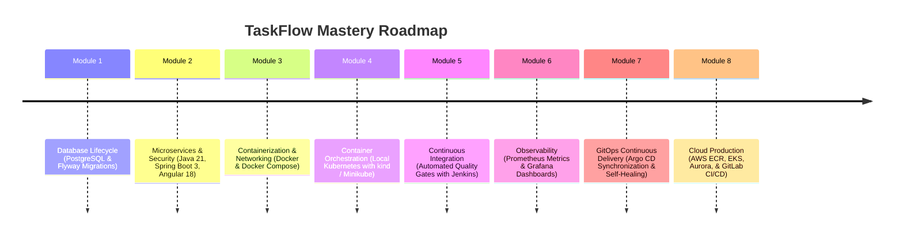

# TaskFlow Learning Roadmap

This document serves as your interactive syllabus and hands-on guide through the 8 learning modules of TaskFlow.

---

## Roadmap Overview

---

## Phase-by-Phase Checklist & Practical Exercises

### [Module 1: PostgreSQL & Flyway](file:///e:/Projects/task_flow_app/TaskFlow/docs/flyway-guide.md)
- [ ] Connect to local PostgreSQL via CLI (`psql`) or pgAdmin.
- [ ] Create `auth_db` and `task_db`.
- [ ] Run `auth-service` and observe Flyway creating `flyway_schema_history`.
- [ ] Add a `V2__add_phone_number_to_users.sql` migration and verify execution.
- [ ] Simulate and resolve a Flyway checksum mismatch.

### [Module 2: Microservices & Frontend](file:///e:/Projects/task_flow_app/TaskFlow/docs/architecture.md)
- [ ] Register a user and verify password hash in PostgreSQL using BCrypt.
- [ ] Inspect the generated JWT on [jwt.io](https://jwt.io).
- [ ] Perform task CRUD using curl / REST client.
- [ ] Verify user isolation (User A cannot see User B's tasks).
- [ ] Launch Angular frontend (`npm start`) and interact with the UI dashboard.

### [Module 3: Docker & Compose](file:///e:/Projects/task_flow_app/TaskFlow/docs/docker-guide.md)
- [ ] Build and launch all 5 services with `docker compose up -d --build`.
- [ ] Test container persistence across container deletion (`docker compose down`).
- [ ] Rebuild a single service with zero downtime (`docker compose up -d --no-deps task-service`).
- [ ] Inspect container networking using `docker exec`.

### [Module 4: Local Kubernetes](file:///e:/Projects/task_flow_app/TaskFlow/docs/kubernetes-guide.md)
- [ ] Deploy the full stack with `kubectl apply -k TaskFlow/deploy/kubernetes`.
- [ ] Dynamically scale `task-service` to 4 replicas (`kubectl scale`).
- [ ] Deliberately crash a pod and observe Kubernetes self-healing.
- [ ] Intentionally misconfigure a Secret and triage `CrashLoopBackOff` using `kubectl describe` and `kubectl logs`.

### [Module 5: Jenkins CI/CD](file:///e:/Projects/task_flow_app/TaskFlow/docs/cicd-guide.md)
- [ ] Launch local Jenkins controller (`docker-compose-jenkins.yml`).
- [ ] Run the declarative pipeline in `ci/jenkins/Jenkinsfile`.
- [ ] Break a test assertion in `AuthServiceTest.java` and observe the pipeline halt.
- [ ] Observe zero-downtime rolling updates in Kubernetes after a successful build.

### [Module 6: Prometheus & Grafana Monitoring](file:///e:/Projects/task_flow_app/TaskFlow/docs/monitoring-guide.md)
- [ ] Launch Prometheus & Grafana stack (`docker-compose-monitoring.yml`).
- [ ] Verify targets in Prometheus (`http://localhost:9090/targets`).
- [ ] Run the PowerShell traffic generator (`.\generate-traffic.ps1`).
- [ ] View real-time request rates, p95 latencies, and JVM heap usage in Grafana.

### [Module 7: GitOps with Argo CD](file:///e:/Projects/task_flow_app/TaskFlow/docs/argocd-gitops-guide.md)
- [ ] Install Argo CD into local Kubernetes.
- [ ] Apply `app-project.yaml` and `application.yaml`.
- [ ] Trigger an unauthorized manual change with `kubectl` and watch Argo CD automatically self-heal.
- [ ] Declaratively scale a service by modifying Git and syncing.

### [Module 8: AWS & Cloud Architecture](file:///e:/Projects/task_flow_app/TaskFlow/docs/aws-deployment-guide.md)
- [ ] Review AWS prerequisites and cost breakdown ([aws-prerequisites-and-costs.md](file:///e:/Projects/task_flow_app/TaskFlow/docs/aws-prerequisites-and-costs.md)).
- [ ] Understand VPC subnet isolation and IRSA ([aws-networking-and-security.md](file:///e:/Projects/task_flow_app/TaskFlow/docs/aws-networking-and-security.md)).
- [ ] Review the GitLab CI/CD pipeline to ECR and EKS.
- [ ] Review cloud cleanup commands ([aws-cleanup.md](file:///e:/Projects/task_flow_app/TaskFlow/docs/aws-cleanup.md)).
