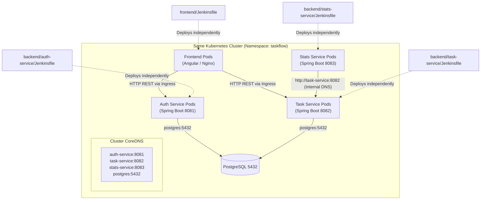

# TaskFlow Guide: Independent Microservice CI/CD Pipelines in Kubernetes

This guide explains how to manage **independent, isolated Jenkins pipelines** located directly within each microservice and the frontend directory. This gives you full control to build, test, and deploy each service individually into the same Kubernetes cluster while preserving seamless inter-service communication.

---

## 1. Why & How Microservices Communicate When Deployed Individually

### The Core Concern:
> *"If each service has its own Jenkinsfile inside its own folder and deploys separately, how do they still communicate with each other in the cluster?"*

### The Kubernetes Solution: Stable `ClusterIP` Services and CoreDNS
In Kubernetes, pods are ephemeral (their IP addresses change when recreated), but **Kubernetes `Service` resources provide permanent, immutable internal DNS names and virtual IPs**:



### Why Independent Deployments Never Break Communication:
1. **Stable ClusterIP Service Endpoints**: When you update `task-service`, its Kubernetes Service (`task-service.taskflow.svc.cluster.local:8082`) **never changes**. The URL remains `http://task-service:8082`.
2. **Zero-Downtime Rolling Updates**: When the `TaskFlow-Task-Service` pipeline runs:
   - Kubernetes spins up a new pod with the new container tag (`v${BUILD_NUMBER}`).
   - The new pod must pass the Spring Boot Actuator readiness probe (`/actuator/health`).
   - Only when the new pod is healthy does Kubernetes route traffic to it and terminate the old pod.
   - During the rollout, `stats-service` continues calling `http://task-service:8082` without missing requests.
3. **Decoupled Lifecycle**: You can release bugfixes or new features to `auth-service` without touching `task-service`, `stats-service`, or `frontend`.

---

## 2. Directory Structure: Jenkinsfiles Inside Each Service

Each microservice encapsulates its own build, test, containerization, and rollout logic within its root directory:

```
TaskFlow/
├── backend/
│   ├── auth-service/
│   │   ├── Dockerfile
│   │   ├── pom.xml
│   │   ├── src/
│   │   └── Jenkinsfile                  <-- Auth Service Pipeline
│   ├── task-service/
│   │   ├── Dockerfile
│   │   ├── pom.xml
│   │   ├── src/
│   │   └── Jenkinsfile                  <-- Task Service Pipeline
│   ├── stats-service/
│   │   ├── Dockerfile
│   │   ├── pom.xml
│   │   ├── src/
│   │   └── Jenkinsfile                  <-- Stats Service Pipeline
│   └── pom.xml
├── frontend/
│   ├── Dockerfile
│   ├── package.json
│   ├── src/
│   └── Jenkinsfile                      <-- Frontend SPA Pipeline
├── deploy/
│   └── kubernetes/
│       ├── auth-service/
│       ├── task-service/
│       ├── stats-service/
│       ├── frontend/
│       ├── postgres/
│       ├── configmap.yaml
│       ├── secret.yaml
│       ├── ingress.yaml
│       └── Jenkinsfile                  <-- Base Infrastructure Pipeline
└── ci/
    └── jenkins/
        └── docker-compose-jenkins.yml   <-- Jenkins server setup
```

---

## 3. Step-by-Step Implementation Guide

### Step 1: Start Jenkins (If not already running)
```powershell
cd TaskFlow/ci/jenkins
docker compose -f docker-compose-jenkins.yml up -d
```
Access Jenkins at `http://localhost:8080`.

---

### Step 2: Deploy Shared Base Infrastructure (`TaskFlow-00-Base-Infra`)
Before individual microservices can run, the shared namespace, database, configurations, and ingress must exist.

1. Open Jenkins (`http://localhost:8080`).
2. Click **New Item** -> Name: `TaskFlow-00-Base-Infra` -> Select **Pipeline** -> Click **OK**.
3. In the configuration:
   - Under **Pipeline**:
     - **Definition**: *Pipeline script from SCM*
     - **SCM**: *Git*
     - **Repository URL**: `e:/Projects/task_flow_app/TaskFlow` (or your Git remote)
     - **Branches to build**: `*/main` (or `*/develop`)
     - **Script Path**: `deploy/kubernetes/Jenkinsfile`
4. Click **Save** and run **Build Now**.

> **What this does:**
> Applies `namespace.yaml`, `configmap.yaml`, `secret.yaml`, `postgres/`, and `ingress.yaml`. Once PostgreSQL is ready, the cluster foundation is set.

---

### Step 3: Create Individual Service Pipelines in Jenkins

Now create a dedicated Pipeline job in Jenkins for each service pointing directly to its internal `Jenkinsfile`:

#### A. Pipeline: `TaskFlow-Auth-Service`
1. Click **New Item** -> Name: `TaskFlow-Auth-Service` -> Select **Pipeline** -> Click **OK**.
2. Under **Pipeline**:
   - **Definition**: *Pipeline script from SCM*
   - **SCM**: *Git*
   - **Repository URL**: `e:/Projects/task_flow_app/TaskFlow`
   - **Script Path**: `backend/auth-service/Jenkinsfile`
3. Click **Save**.

#### B. Pipeline: `TaskFlow-Task-Service`
1. Click **New Item** -> Name: `TaskFlow-Task-Service` -> Select **Pipeline** -> Click **OK**.
2. Under **Pipeline**:
   - **Definition**: *Pipeline script from SCM*
   - **SCM**: *Git*
   - **Repository URL**: `e:/Projects/task_flow_app/TaskFlow`
   - **Script Path**: `backend/task-service/Jenkinsfile`
3. Click **Save**.

#### C. Pipeline: `TaskFlow-Stats-Service`
1. Click **New Item** -> Name: `TaskFlow-Stats-Service` -> Select **Pipeline** -> Click **OK**.
2. Under **Pipeline**:
   - **Definition**: *Pipeline script from SCM*
   - **SCM**: *Git*
   - **Repository URL**: `e:/Projects/task_flow_app/TaskFlow`
   - **Script Path**: `backend/stats-service/Jenkinsfile`
3. Click **Save**.

#### D. Pipeline: `TaskFlow-Frontend`
1. Click **New Item** -> Name: `TaskFlow-Frontend` -> Select **Pipeline** -> Click **OK**.
2. Under **Pipeline**:
   - **Definition**: *Pipeline script from SCM*
   - **SCM**: *Git*
   - **Repository URL**: `e:/Projects/task_flow_app/TaskFlow`
   - **Script Path**: `frontend/Jenkinsfile`
3. Click **Save**.

---

### Step 4: Configure Path-Based Git Triggers (Monorepo Optimization)

To trigger builds **only** when files in a service's own directory are modified:
1. Open the job configuration in Jenkins (e.g., `TaskFlow-Auth-Service`).
2. Under **Pipeline** -> **SCM: Git**, click **Additional Behaviours** -> **Add** -> **Polling ignores commits in certain paths**.
3. In **Included Regions**, specify the matching folder paths:
   - For **Auth Service**:
     ```
     backend/auth-service/.*
     deploy/kubernetes/auth-service/.*
     ```
   - For **Task Service**:
     ```
     backend/task-service/.*
     deploy/kubernetes/task-service/.*
     ```
   - For **Stats Service**:
     ```
     backend/stats-service/.*
     deploy/kubernetes/stats-service/.*
     ```
   - For **Frontend**:
     ```
     frontend/.*
     deploy/kubernetes/frontend/.*
     ```
4. Under **Build Triggers**, check **Poll SCM** (e.g. `H/5 * * * *`).

---

### Step 5: How Each Microservice Jenkinsfile Operates

Take `backend/auth-service/Jenkinsfile` as an example:

1. **Targeted Maven Build & Tests**:
   ```sh
   dir('backend') {
       sh 'mvn clean verify -pl auth-service -am -Djava.version=21'
   }
   ```
   - Compiles and runs JUnit tests **only** for `auth-service`.
   - Visualizes Surefire test results in Jenkins UI (`junit testResults: 'backend/auth-service/target/surefire-reports/*.xml'`).

2. **Container Image Build**:
   ```sh
   docker build -t taskflow-auth-service:v${BUILD_NUMBER} -t taskflow-auth-service:latest -f backend/auth-service/Dockerfile backend
   ```
   - Creates a tagged Docker image specifically for `auth-service`.

3. **Cluster Ingestion**:
   ```sh
   kind load docker-image taskflow-auth-service:v${BUILD_NUMBER} --name taskflow || true
   ```
   - Loads the image into the local Kubernetes nodes without requiring an external registry.

4. **Rolling Update to Kubernetes**:
   ```sh
   kubectl apply -f deploy/kubernetes/auth-service/ -n taskflow
   kubectl set image deployment/auth-service auth-service=taskflow-auth-service:v${BUILD_NUMBER} -n taskflow
   kubectl rollout status deployment/auth-service -n taskflow --timeout=120s
   ```
   - Applies any service/deployment manifest changes and updates the container image.
   - Waits for the Actuator `/actuator/health` probe to turn green before marking the build as SUCCESS.

---

## 4. Verification & Testing

### Verification 1: Deploy Only Auth Service
1. In Jenkins, go to `TaskFlow-Auth-Service` and click **Build Now**.
2. Run in your terminal:
   ```powershell
   kubectl get pods -n taskflow -w
   ```
3. Observe:
   - Only `auth-service` pods are updated with rolling updates.
   - `task-service`, `stats-service`, and `postgres` remain online and uninterrupted.

### Verification 2: Verify Inter-Service Communication
1. `stats-service` makes HTTP REST calls to `http://task-service:8082`.
2. Port-forward the stats service:
   ```powershell
   kubectl port-forward svc/stats-service 8083:8083 -n taskflow
   ```
3. Check health and stats API:
   ```powershell
   curl http://localhost:8083/actuator/health
   ```
4. While polling or sending requests, trigger **`TaskFlow-Task-Service`**.
5. Observe zero failed requests, because Kubernetes routes traffic to active replicas until the new pod's readiness probe succeeds.

---

## 5. Summary Table

| Service | Jenkinsfile Location | Jenkins Job Name | Deployed Resources |
| :--- | :--- | :--- | :--- |
| **Shared Infra** | `deploy/kubernetes/Jenkinsfile` | `TaskFlow-00-Base-Infra` | Namespace, ConfigMap, Secrets, Postgres, Ingress |
| **Auth Service** | `backend/auth-service/Jenkinsfile` | `TaskFlow-Auth-Service` | `deployment/auth-service`, `svc/auth-service` |
| **Task Service** | `backend/task-service/Jenkinsfile` | `TaskFlow-Task-Service` | `deployment/task-service`, `svc/task-service` |
| **Stats Service** | `backend/stats-service/Jenkinsfile` | `TaskFlow-Stats-Service` | `deployment/stats-service`, `svc/stats-service` |
| **Frontend** | `frontend/Jenkinsfile` | `TaskFlow-Frontend` | `deployment/frontend`, `svc/frontend` |
