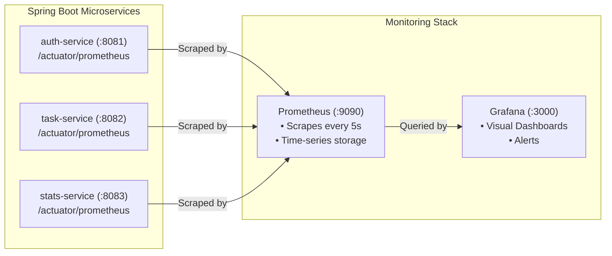

# TaskFlow Monitoring Guide: Prometheus & Grafana

This guide details local observability and monitoring for TaskFlow using **Spring Boot Actuator**, **Micrometer**, **Prometheus**, and **Grafana** without requiring AWS CloudWatch or Datadog.

---

## 1. Observability Architecture Overview



---

## 2. Core Concepts: The 3 Pillars of Observability

| Pillar | What It Is | Example in TaskFlow |
| :--- | :--- | :--- |
| **Metrics** | Numeric aggregations measured over intervals of time | `http_server_requests_seconds_count` (calls per second), `jvm_memory_used_bytes` (heap usage). |
| **Logs** | Discrete, timestamped event records | `User alex logged in successfully`, `PSQLException connection refused`. |
| **Traces** | End-to-end journey of a single user request across distributed microservices | A request starting from Angular -> Stats Service -> Task Service -> PostgreSQL. |

---

## 3. Technology Roles

1. **Spring Boot Actuator**: Provides built-in production-ready endpoints (`/actuator/health`, `/actuator/metrics`, `/actuator/prometheus`).
2. **Micrometer**: The "SLF4J for metrics" — a vendor-neutral facade that converts internal JVM and HTTP metrics into Prometheus text format.
3. **Prometheus**: A pull-based time-series database. It regularly polls (scrapes) registered HTTP endpoints and stores time-stamped metric samples.
4. **Grafana**: A visualization UI that queries Prometheus via **PromQL** and renders real-time graphs, gauges, and charts.

---

## 4. Starting the Monitoring Stack Locally

### Step 1: Launch Prometheus & Grafana
```powershell
cd TaskFlow/deploy/monitoring
docker compose -f docker-compose-monitoring.yml up -d
```

### Step 2: Access the Interfaces
- **Prometheus UI**: `http://localhost:9090`
- **Prometheus Targets Status**: `http://localhost:9090/targets` (All services should show state `UP`).
- **Grafana UI**: `http://localhost:3000`
  - **Username**: `admin`
  - **Password**: `admin`

### Step 3: Open the Dashboard
In Grafana, go to **Dashboards** -> **TaskFlow** -> **TaskFlow Microservices Overview**.

---

## 5. Key PromQL Queries Explained

Here are the exact PromQL expressions used in the TaskFlow Grafana dashboard:

### 1. HTTP Request Rate (Throughput per second)
```promql
sum(rate(http_server_requests_seconds_count[1m])) by (application)
```
- `http_server_requests_seconds_count`: Total requests handled.
- `rate(...[1m])`: Calculates the per-second rate of increase over the last 1 minute.
- `sum(...) by (application)`: Groups the results by service name (`auth-service`, `task-service`, `stats-service`).

### 2. 95th Percentile Response Latency (p95)
```promql
histogram_quantile(0.95, sum(rate(http_server_requests_seconds_bucket[1m])) by (le, application))
```
- Returns the maximum time taken by the fastest 95% of requests.

### 3. JVM Heap Memory Usage
```promql
sum(jvm_memory_used_bytes{area="heap"}) by (application)
```
- Monitors live memory consumed by the Spring Boot garbage-collected heap.

---

## 6. Hands-on Learning Exercises

### Exercise 1: Inspecting Raw Metric Formats
1. Open your browser to `http://localhost:8081/actuator/prometheus`.
2. Find the metric line starting with `http_server_requests_seconds_count`.
3. Notice how Prometheus metrics are plain key-value text pairs with labels:
   ```text
   http_server_requests_seconds_count{application="auth-service",method="GET",outcome="SUCCESS",status="200",uri="/actuator/health"} 42.0
   ```

### Exercise 2: Simulating Traffic and Observing Live Spikes
1. In a terminal, run the traffic generator:
   ```powershell
   cd TaskFlow/deploy/monitoring
   .\generate-traffic.ps1
   ```
2. Open Grafana at `http://localhost:3000`.
3. Watch the **HTTP Request Rate** and **Live JVM Threads** graphs spike upward in real time.
4. Stop the script (`Ctrl + C`) and observe the rate settle back down.
